<!-- readme-standard: 2026-11-02 -->

# Root Landing Page — Christopher Stephen Wilson

*A simple entry point with a clearer atmosphere*

 **You are here:** drasticstatic › `drasticstatic.github.io` · public · `main` is the working branch

##  TL;DR

1.  **What this is.** The intentionally minimal root site of drasticstatic.github.io.
2.  **Who it is for.** Anyone who arrived at the root and is looking for Christopher's work.
3.  **Do this first.** Go on to [the fuller portfolio](https://drasticstatic.github.io/resume/).

---

### This root site is intentionally minimal

**the fuller PORTFOLIO experience** is live at [~/resume/](https://drasticstatic.github.io/resume/)

##  Suggest a change

Noticed something? Open an [issue](../../issues) or a pull request against `main`; Christopher reads them and a person with the role merges. Not on GitHub? Reach him through any channel on [his profile](https://github.com/drasticstatic).

The front door follows the living [README standard](https://github.com/drasticstatic/my-template/blob/main/README-STANDARD.md). Copy it, improve it.
